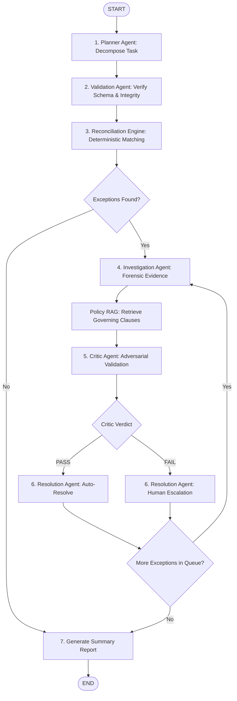

# FinRecon — Agentic Financial Transaction Reconciliation & Exception Resolution System

[](https://www.python.org/downloads/)
[](https://github.com/langchain-ai/langgraph)
[](https://streamlit.io/)
[](#core-architecture-hybrid-ai)
[](https://opensource.org/licenses/MIT)

**FinRecon** is an **Agentic AI Proof of Concept (PoC)** designed for the **FinTech / Financial Operations** domain. 

In modern digital commerce, the same transaction is recorded across internal order databases, payment gateways, settlement batches, bank statements, refund ledgers, and dispute logs. Even when every system operates as expected, differences arise due to payment gateway processing fees, Goods and Services Tax (GST), settlement delays, partial disbursements, and customer disputes.

Traditional reconciliation software merely detects raw numerical differences, leaving financial analysts to manually investigate spreadsheets and portals. **FinRecon transforms this manual investigation into an autonomous, verifiable agentic workflow**: it investigates **WHY** records differ, verifies applicable financial policies using **RAG**, cross-checks evidence, adversarially critiques findings, and determines whether an exception can be safely auto-resolved or requires human escalation.

---

## Table of Contents
- [The Business Problem](#the-business-problem)
- [Core Architecture: Hybrid AI](#core-architecture-hybrid-ai)
- [Multi-Agent System Architecture](#multi-agent-system-architecture)
- [How It Works (LangGraph Workflow)](#how-it-works-langgraph-workflow)
- [Policy RAG & Knowledge Base](#policy-rag--knowledge-base)
- [Adversarial Critic & Safety Guardrails](#adversarial-critic--safety-guardrails)
- [Quantitative Evaluation & Results](#quantitative-evaluation--results)
- [Repository Structure](#repository-structure)
- [Installation & Quick Start](#installation--quick-start)
- [Running Automated Tests](#running-automated-tests)
- [Demonstration Walkthrough](#demonstration-walkthrough)

---

## The Business Problem

Consider a standard e-commerce transaction:
```text
Customer places Order (ORD-1829):      ₹5,000
Payment Gateway captures (TXN-8821):    ₹5,000
Settlement Report deposits (SET-7712):   ₹4,850
Bank Statement records credit:          ₹4,800
```

A finance analyst must answer:
1. *Why does the settlement deposit differ by ₹150 from the captured payment?*
2. *Was a ₹100 gateway fee and ₹50 GST deducted, or is this an unauthorized variance?*
3. *Did the fee comply with contractual Merchant Discount Rate (MDR) caps?*
4. *Can this transaction be auto-resolved, or does it mandate human review?*

Conventional systems flag the ₹150 discrepancy as a failure, escalating **100% of differences** to human analysts. FinRecon automates this investigation while enforcing mathematical rigor.

---

## Core Architecture: Hybrid AI

Financial operations demand **zero tolerance for mathematical hallucination**. FinRecon adheres to a strict **Hybrid AI design**:

```
+---------------------------------------------------------------------------------+
|                               HYBRID AI PATTERN                                 |
+---------------------------------------------------------------------------------+
|  DETERMINISTIC CODE (Python / Pandas / Math)                                    |
|  • Exact relational joins across Order, Payment, and Settlement IDs             |
|  • Cent-exact arithmetic balance verification:                                   |
|       Payment - Gateway Fee - Tax == Settlement                                 |
|  • Pydantic schema validation preventing malformed data ingestion               |
+---------------------------------------------------------------------------------+
|  PROBABILISTIC INTELLIGENCE (LLM Agents + LangGraph + Policy RAG)               |
|  • Goal-oriented task decomposition and adaptive workflow planning              |
|  • Cross-system forensic evidence gathering                                     |
|  • Semantic policy clause retrieval from institutional markdown policies        |
|  • Adversarial critique catching unauthorized fees and policy cap violations    |
|  • Natural language audit trail and explainable dossier generation              |
+---------------------------------------------------------------------------------+
```

---

## Multi-Agent System Architecture

FinRecon coordinates specialized agents, each possessing bounded responsibilities:

| Agent Name | Role | Core Responsibility |
| :--- | :--- | :--- |
| **Planner Agent** | Workflow Orchestrator | Decomposes natural language requests into structured execution tasks and identifies required dataset dependencies. |
| **Validation Agent** | Data Integrity Guard | Pre-screens incoming financial datasets for schema adherence, missing keys, and negative amounts before reasoning. |
| **Reconciliation Engine** | Deterministic Matcher | Runs a multi-stage matching hierarchy (Exact ID $\to$ Order $\to$ Window) to detect clean matches and isolate exceptions. |
| **Investigation Agent** | Forensic Investigator | Deep-dives into anomalies along dedicated paths (`AMOUNT_MISMATCH`, `POSSIBLE_DUPLICATE`, `MISSING_SETTLEMENT`, `REFUND_MISMATCH`). Queries fees, disputes, and refunds. |
| **Policy RAG Agent** | Legal & Compliance Retriever | Grounds investigation in institutional policies using sublinear TF-IDF vector similarity and semantic header chunking. |
| **Critic Agent** | Adversarial Auditor | Evaluates hypotheses against mathematical integrity, legal fee caps, and evidence completeness. Blocks invalid auto-resolutions. |
| **Resolution Agent** | Decision & Routing Executive | Assigns final business actions (`AUTO_RESOLVE_VALID_FEE`, `FLAG_SUSPECTED_DUPLICATE`, `ESCALATE_GATEWAY_SETTLEMENT`, `REQUIRES_HUMAN_REVIEW`). |

---

## How It Works (LangGraph Workflow)

The system executes as a compiled, stateful **LangGraph** state machine maintaining an immutable `FinReconState`:



### Dynamic Conditional Routing
- **Zero-Exception Short-Circuit**: If a dataset contains 100% matched transactions, the graph skips the investigation loop and routes directly to reporting.
- **Exception Loop Controller**: Iterates over the exception queue sequentially, pairing forensic evidence, RAG policy citations, and critic verdicts for every discrepancy.
- **Critic Escalation Edge**: Any case failing mathematical balance or exceeding policy caps (such as Case 6 contradictory evidence) is blocked from auto-resolution and assigned to human review.

---

## Policy RAG & Knowledge Base

To ensure regulatory grounding, FinRecon indexes institutional markdown policies in `knowledge/`:
- **`fee_schedule.md`**: MDR rates (UPI 0%, Cards 2%), 18% GST rules, and standard ₹300 fee cap.
- **`settlement_policy.md`**: T+2 standard settlement timeline, T+5 missing settlement rules, zero-tolerance policy.
- **`refund_policy.md`**: Mandatory linkage to original payment, cumulative refund limits, duplicate refund rules.
- **`dispute_policy.md`**: Customer "charged twice" decision matrix (true duplicate vs. separate orders vs. pre-reversed charges).
- **`escalation_policy.md`**: Human-in-the-Loop triggers (unexplained variance > ₹500, contradictory records, critic rejection).

The vector store parses documents by level-2 (`##`) headers, indexes them using sublinear TF-IDF and cosine similarity, and caches vectors to disk (`rag/faiss_index/`), returning verifiable text citations for each decision.

---

## Adversarial Critic & Safety Guardrails

FinRecon incorporates multi-layered safety guardrails:
1. **No Autonomous Money Movement**: The system operates strictly as decision support; it cannot trigger bank wires or fund transfers.
2. **Four-Point Critic Verification**:
   - *Mathematical Balance*: Checks if $\text{Payment} - \text{Fee} - \text{Tax} == \text{Settlement}$ (0.00 variance).
   - *Policy Fee Cap*: Rejects any fee deduction exceeding the ₹300 policy cap, even if mathematically balanced.
   - *Evidence Completeness*: Ensures cited fee or refund IDs exist in ground-truth data.
   - *Contradiction Detection*: Immediately rejects cases with conflicting records (e.g., ₹500 discrepancy with only ₹200 fee documentation).
3. **Human-in-the-Loop (HITL) Workstation**:
   - Flagged exceptions display detailed audit dockets with Mermaid visual lifecycles.
   - One-click reviewer actions: `[Approve Fee Adjustment]`, `[Escalate to Gateway Desk]`, and `[Mark for Fraud Review]`.
   - All reviewer decisions and audit notes persist to `data/reconciliation_audit.jsonl`.

---

## Quantitative Evaluation & Results

FinRecon includes an automated benchmark suite (`evaluation/run_benchmark.py`) comparing the Agentic Workflow against a conventional rule-based matcher:

| Metric | Traditional Rule Baseline | FinRecon Agentic Workflow | Improvement / Impact |
| :--- | :---: | :---: | :--- |
| **Exception Detection Rate** | 100.0% (raw diffs) | **100.0%** | Full sensitivity maintained |
| **Root Cause Explanation** | 0.0% (None) | **100.0%** | Evidence & policy citations generated |
| **Policy RAG Grounding** | No (Manual lookup) | **Yes (Automated)** | Verbatim legal clause citations |
| **Auto-Resolution Rate** | 0.0% (0 cases) | **85.7%** | Legitimate fees verified automatically |
| **Human Review Burden** | 100.0% (All differences) | **14.3%** | Escalates ambiguous / high-risk cases only |
| **Human Review Workload Reduction** | 0.0% | **85.7% Saved** | Massive operational efficiency gain |
| **Case 6 Contradiction Safety** | Fails (Unclassified) | **100% Escalated** | 0.0% False Auto-Resolutions |
| **Execution Latency** | 0.006s | **0.112s** | Sub-second batch multi-agent execution |

---

## Repository Structure

```text
FinRecon/
├── app.py                     # Streamlit Operations Dashboard entrypoint
├── config.py                  # Centralized configuration (paths, LLM providers)
├── requirements.txt           # Python dependency specifications
├── .env.example               # Environment template (zero API keys required)
│
├── agents/                    # Specialized AI Agents
│   ├── base_agent.py          # Unified agent provider interface (Ollama/Mock/APIs)
│   ├── planner_agent.py       # Task decomposition & planning
│   ├── validation_agent.py    # Pre-flight data schema guard
│   ├── investigation_agent.py # Forensic anomaly investigator
│   ├── critic_agent.py        # Adversarial auditor & hallucination checker
│   └── resolution_agent.py    # Business decision & routing executive
│
├── tools/                     # Deterministic & Mathematical Engines
│   ├── data_tools.py          # CSV loaders, schema validators, record queries
│   ├── math_tools.py          # Cent-exact arithmetic verification & refund limits
│   ├── reconciliation_tools.py# Multi-stage matching hierarchy & duplicate detector
│   └── exception_types.py     # Pydantic models & reconciliation enums
│
├── rag/                       # Policy RAG Knowledge Pipeline
│   ├── ingestion.py           # Markdown section parsing & semantic chunking
│   ├── vector_store.py        # Sublinear TF-IDF & cosine vector store with disk cache
│   └── retriever.py           # Domain-filtered search tools (fee, escalation)
│
├── workflows/                 # LangGraph Multi-Agent Orchestration
│   ├── state.py               # FinReconState TypedDict definition
│   ├── nodes.py               # Agent and tool execution nodes with audit logger
│   ├── edges.py               # Conditional routing & exception loop controller
│   └── graph.py               # Compiled StateGraph assembly & pipeline runner
│
├── reporting/                 # Explainability & Visual Artifacts
│   ├── evidence_graph.py      # Directed lifecycle builder & Mermaid diagram generator
│   ├── audit_logger.py        # Append-only structured JSONL audit trail
│   └── report_generator.py    # Executive summaries & forensic exception dossiers
│
├── evaluation/                # Quantitative Evaluation Suite
│   ├── baseline_rules.py      # Conventional rule-based matcher baseline
│   ├── metrics.py             # Calculator for the 7 core project metrics
│   └── run_benchmark.py       # Head-to-head comparative benchmark runner
│
├── data/                      # Synthetic Datasets & Ground Truth
│   ├── generator.py           # Controlled generator injecting 6 canonical anomaly cases
│   ├── orders.csv             # 1,000 synthetic merchant orders
│   ├── payments.csv           # Captured gateway transactions (includes duplicates)
│   ├── settlements.csv        # Net settlements deposited to merchant
│   ├── fees.csv               # Processing fees and GST breakdowns
│   ├── refunds.csv            # Customer refunds (includes excess refund anomaly)
│   ├── disputes.csv           # Customer dispute claims (chargeback / duplicate claims)
│   ├── customers.csv          # Customer profiles and tiers
│   └── ground_truth_labels.json # Labeled validation ground truth
│
├── knowledge/                 # Institutional Policy Markdown Files
│   ├── fee_schedule.md        # Gateway fee pricing & ₹300 maximum cap
│   ├── settlement_policy.md   # T+2 settlement timeline & zero-tolerance rule
│   ├── refund_policy.md       # Refund caps and duplicate refund prevention
│   ├── dispute_policy.md      # Double-charge dispute resolution matrix
│   └── escalation_policy.md   # Mandatory human review criteria
│
├── ui/                        # Frontend Workstation
│   ├── styles.css             # Clean FinTech dashboard theme
│   └── components/            # Modular Streamlit UI components
│       ├── sidebar.py         # Data sources, policy viewer & trigger controls
│       ├── kpi_metrics.py     # Executive metric cards
│       ├── exception_table.py # Filterable exception queue
│       ├── agent_timeline.py  # Real-time multi-agent orchestration activity feed
│       ├── evidence_view.py   # Forensic dossier, math equation & Mermaid graph
│       └── hitl_modal.py      # Human-in-the-Loop decision controls
│
└── tests/                     # Automated Test Suites (32 Tests Passing)
    ├── test_phase1_data.py
    ├── test_phase2_tools.py
    ├── test_phase3_rag.py
    ├── test_phase4_agents.py
    ├── test_phase5_workflow.py
    ├── test_phase6_reporting.py
    ├── test_phase7_eval.py
    └── test_phase8_ui.py
```

---

## Installation & Quick Start

### 1. Clone the Repository
```bash
git clone https://github.com/imWordy/FinRecon.git
cd FinRecon
```

### 2. Set Up Virtual Environment & Dependencies
```bash
python -m venv venv
# On Windows:
venv\Scripts\activate
# On Linux/macOS:
source venv/bin/activate

pip install -r requirements.txt
```

### 3. Generate Synthetic Financial Data
```bash
python data/generator.py
```

### 4. Launch the Interactive Streamlit Workstation
```bash
streamlit run app.py
```
Open your browser at `http://localhost:8501` to interact with the live dashboard.

---

## Running Automated Tests

FinRecon is covered by **32 comprehensive test cases** spanning data integrity, deterministic tools, RAG search, agents, LangGraph state transitions, reporting, benchmark comparisons, and headless Streamlit execution:

```bash
# Run the entire test suite
pytest tests/ -v
```

Expected output:
```text
tests/test_phase1_data.py::test_tc_p1_01_dataset_generation_integrity PASSED
tests/test_phase1_data.py::test_tc_p1_02_schema_and_key_relationships PASSED
tests/test_phase1_data.py::test_tc_p1_03_ground_truth_distribution PASSED
tests/test_phase1_data.py::test_tc_p1_04_knowledge_base_accessibility PASSED
tests/test_phase2_tools.py::test_tc_p2_01_strict_schema_validation PASSED
tests/test_phase2_tools.py::test_tc_p2_02_exact_match_accuracy PASSED
tests/test_phase2_tools.py::test_tc_p2_03_discrepancy_detection PASSED
tests/test_phase2_tools.py::test_tc_p2_04_duplicate_flagging PASSED
tests/test_phase2_tools.py::test_tc_p2_05_arithmetic_verification PASSED
tests/test_phase3_rag.py::test_tc_p3_01_ingestion_and_vector_index_creation PASSED
tests/test_phase3_rag.py::test_tc_p3_02_fee_policy_retrieval_accuracy PASSED
tests/test_phase3_rag.py::test_tc_p3_03_escalation_policy_retrieval PASSED
tests/test_phase3_rag.py::test_tc_p3_04_grounding_metadata_integrity PASSED
tests/test_phase4_agents.py::test_tc_p4_01_planner_task_breakdown PASSED
tests/test_phase4_agents.py::test_tc_p4_02_validation_agent PASSED
tests/test_phase4_agents.py::test_tc_p4_03_investigation_and_critic_valid_deduction PASSED
tests/test_phase4_agents.py::test_tc_p4_04_investigation_and_critic_rejection_on_contradiction PASSED
tests/test_phase5_workflow.py::test_tc_p5_01_graph_compilation PASSED
tests/test_phase5_workflow.py::test_tc_p5_02_zero_exception_path PASSED
tests/test_phase5_workflow.py::test_tc_p5_03_end_to_end_batch_execution PASSED
tests/test_phase5_workflow.py::test_tc_p5_04_state_audit_trail_completeness PASSED
tests/test_phase6_reporting.py::test_tc_p6_01_evidence_graph_generation PASSED
tests/test_phase6_reporting.py::test_tc_p6_02_mathematical_equation_in_summary PASSED
tests/test_phase6_reporting.py::test_tc_p6_03_audit_log_serialization PASSED
tests/test_phase7_eval.py::test_tc_p7_01_rule_based_baseline_execution PASSED
tests/test_phase7_eval.py::test_tc_p7_02_exception_detection_benchmark PASSED
tests/test_phase7_eval.py::test_tc_p7_03_zero_false_auto_resolution_on_case_6 PASSED
tests/test_phase7_eval.py::test_tc_p7_04_benchmark_report_output PASSED
tests/test_phase8_ui.py::test_tc_p8_01_streamlit_headless_initialization PASSED
tests/test_phase8_ui.py::test_tc_p8_02_kpi_metrics_rendered PASSED
tests/test_phase8_ui.py::test_tc_p8_03_exception_table_presence PASSED
tests/test_phase8_ui.py::test_tc_p8_04_hitl_interaction PASSED

============================= 32 passed in 4.53s ==============================
```

To run the comparative benchmark:
```bash
python evaluation/run_benchmark.py
```

---

## Demonstration Walkthrough

When presenting or testing FinRecon:
1. **Explore the Sidebar**: Verify all 7 relational datasets and 5 policy files are active. Adjust the batch size slider (e.g., 50 transactions).
2. **Execute Reconciliation**: Click **"Run FinRecon Workflow"**.
3. **Inspect Executive KPIs**: Observe Total Processed, Matched transactions, Exceptions Flagged, and the percentage Auto-Resolved vs. Escalated.
4. **Follow Agent Execution**: Expand the **"Multi-Agent Orchestration Activity Feed"** to trace timestamped actions from Planner $\to$ Validator $\to$ Reconciler $\to$ Investigator $\to$ Critic $\to$ Resolver.
5. **Inspect Case 2 (Auto-Resolved Fee)**:
   - Select an amount mismatch exception (`ORD-0010`).
   - Observe the mathematical equation (`5000.00 - 100.00 - 50.00 = 4850.00`), the green balanced badge, the Mermaid lifecycle graph, and the retrieved fee schedule policy.
6. **Inspect Case 6 (Adversarial Critic Escalation)**:
   - Select an unresolved discrepancy (`ORD-0070`).
   - Observe the red variance warning (`500.00 - 200.00 = 300.00 unexplained difference`).
   - Notice that the **Critic Agent physically blocked auto-resolution** due to policy contradiction.
   - Use the **Human-in-the-Loop controls** (`[Approve Fee Adjustment]`, `[Escalate to Gateway Desk]`, `[Mark for Fraud Review]`) to review and commit the human decision to the audit log.

---

## License

This project is licensed under the [MIT License](LICENSE).
